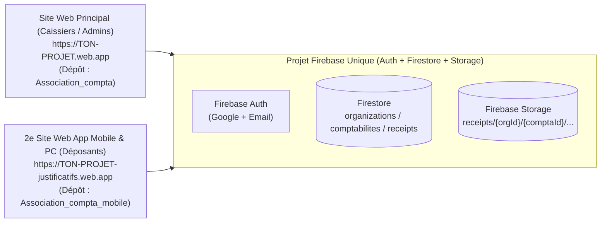

# Guide de Test & Déploiement Firebase — AssoCompta Justificatifs (Web App Mobile & PC)

Ce guide récapitule toutes les étapes pour tester et déployer l'application **AssoCompta Justificatifs** (`Association_compta_mobile`) chez vous, sur **une seconde adresse web (Firebase Hosting)** connectée au **même projet Firebase** que l'application principale `Association_compta`.

---

## 1. Architecture : 1 seul projet Firebase, 2 adresses Web



> [!IMPORTANT]
> Vous n'avez **pas** besoin de créer un nouveau projet Firebase. Les deux applications partagent les mêmes utilisateurs, les mêmes organisations/comptabilités et le même espace de stockage des justificatifs.

---

## 2. Récupérer les deux dépôts chez vous

Assurez-vous d'être sur la branche `ameliorationv2` pour l'application principale et `main` pour l'application de justificatifs :

```powershell
# 1. Application principale (Comptabilité)
git clone https://github.com/jknebel/Association_compta.git
cd Association_compta
git checkout ameliorationv2
npm install

# 2. Application Mobile & PC d'envoi de justificatifs
cd ..
git clone https://github.com/jknebel/Association_compta_mobile.git
cd Association_compta_mobile
git checkout main
npm install
```

---

## 3. Configurer le fichier `.env` dans `Association_compta_mobile`

Dans le dossier `Association_compta_mobile`, copiez le fichier `.env.example` en `.env` :

```powershell
cp .env.example .env
```

Remplissez `.env` avec **exactement les mêmes variables Firebase et Gemini** que celles de votre projet `Association_compta` :

```env
# Configuration Firebase partagée avec AssoCompta AI (Web)
VITE_FIREBASE_API_KEY=AIzaSy...
VITE_FIREBASE_AUTH_DOMAIN=ton-projet.firebaseapp.com
VITE_FIREBASE_PROJECT_ID=ton-projet
VITE_FIREBASE_STORAGE_BUCKET=ton-projet.firebasestorage.app
VITE_FIREBASE_MESSAGING_SENDER_ID=1234567890
VITE_FIREBASE_APP_ID=1:1234567890:web:abcdef123456

# Clé API Gemini pour l'extraction automatique (Montant TTC, Date, Fournisseur)
VITE_GEMINI_API_KEY=AIzaSy...
```

---

## 4. Tester en local (PC + Téléphone sur le même Wi-Fi)

```powershell
cd Association_compta_mobile
npm run dev
```

1. **Sur votre PC** : ouvrez `http://localhost:5173`
   - Vous verrez l'interface **Bureau (2 colonnes)** avec la zone de glisser-déposer (`Drag & Drop`) pour vos factures PDF / images à gauche et l'historique en temps réel à droite.
2. **Sur votre téléphone** (connecté au même Wi-Fi que le PC) :
   - Regardez la ligne `➜ Network: http://192.168.x.x:5173/` affichée dans le terminal et ouvrez cette adresse sur le navigateur du téléphone.
   - Vous aurez accès aux 3 boutons : **Prendre une photo**, **Galerie photos**, et **Importer un PDF**.

> [!TIP]
> Si vous lancez `npm run dev` sans fichier `.env`, un bouton **« Continuer en mode démo local »** apparaît automatiquement pour vous permettre de tester toute l'interface hors-ligne.

---

## 5. Déployer les règles de sécurité Firebase (`SEC-01`)

Avant d'utiliser le rôle **« Déposant de justificatifs (`uploader`) »** en production, déployez les règles Firestore et Storage mises à jour depuis le dépôt principal `Association_compta` (branche `ameliorationv2`) :

```powershell
cd Association_compta
npx firebase-tools login
npx firebase-tools deploy --only firestore:rules,storage --project TON_PROJECT_ID
```

Ces règles garantissent que :
- Un membre avec le rôle **`uploader`** peut uniquement ajouter un justificatif (`image/*` ou `application/pdf`, max `5 Mo`) dans les comptabilités auxquelles il a accès et consulter ses propres envois.
- Il ne peut lire aucune transaction bancaire ni aucun compte comptable.

---

## 6. Déployer la Web App sur une 2e adresse Firebase Hosting

### Étape 6.1 — Créer le fichier `firebase.json` dans `Association_compta_mobile`
Créez un fichier `firebase.json` à la racine de `Association_compta_mobile` avec ce contenu :

```json
{
  "hosting": {
    "target": "mobile",
    "public": "dist",
    "ignore": [
      "firebase.json",
      "**/.*",
      "**/node_modules/**"
    ],
    "rewrites": [
      {
        "source": "**",
        "destination": "/index.html"
      }
    ]
  }
}
```

### Étape 6.2 — Créer le 2e site Firebase Hosting et le lier
Choisissez un nom d'adresse unique, par exemple `ton-projet-justificatifs` (qui donnera l'adresse `https://ton-projet-justificatifs.web.app`) :

```powershell
cd Association_compta_mobile

# 1. Créer le nouveau site dans votre projet Firebase existant
npx firebase-tools hosting:sites:create ton-projet-justificatifs --project TON_PROJECT_ID

# 2. Associer la cible "mobile" (définie dans firebase.json) à ce nouveau site
npx firebase-tools target:apply hosting mobile ton-projet-justificatifs --project TON_PROJECT_ID
```

### Étape 6.3 — Compiler et déployer
```powershell
npm run build
npx firebase-tools deploy --only hosting:mobile --project TON_PROJECT_ID
```

À la fin de la commande, Firebase affichera l'URL publique de votre Web App :
`Hosting URL: https://ton-projet-justificatifs.web.app`

### Étape 6.4 — Vérifier les domaines autorisés pour Google Sign-In
1. Ouvrez la [Console Firebase](https://console.firebase.google.com/) -> votre projet.
2. Allez dans **Authentication** -> **Settings (Paramètres)** -> **Authorized domains (Domaines autorisés)**.
3. Vérifiez que `ton-projet-justificatifs.web.app` et `ton-projet-justificatifs.firebaseapp.com` figurent dans la liste (ajoutez-les si nécessaire).

---

## 7. Installer la Web App sur votre Téléphone et votre PC (PWA)

Une fois déployée sur `https://ton-projet-justificatifs.web.app` :

- **Sur iPhone (Safari)** :
  1. Ouvrez `https://ton-projet-justificatifs.web.app` dans Safari.
  2. Appuyez sur le bouton **Partager** (carré avec flèche vers le haut).
  3. Choisissez **« Sur l'écran d'accueil »** (*Add to Home Screen*).
- **Sur Android (Chrome)** :
  1. Ouvrez `https://ton-projet-justificatifs.web.app` dans Chrome.
  2. Appuyez sur **« Installer l'application »** (ou menu `⋮` -> **« Ajouter à l'écran d'accueil »**).
- **Sur PC (Chrome / Edge)** :
  1. Cliquez sur l'icône d'installation dans la barre d'adresse à droite pour l'avoir comme application de bureau dédiée.

---

## 8. Parcours complet pour tester de bout en bout

1. **Dans `Association_compta` (Administration)** :
   - Attribuez à un membre le rôle **« Déposant de justificatifs »** (`uploader`) ou **« Caissier »** sur une ou plusieurs comptabilités.
2. **Dans `Association_compta_mobile` (Téléphone ou PC)** :
   - Connectez-vous avec ce compte.
   - Sélectionnez la comptabilité cible (si plusieurs comptabilités sont autorisées).
   - Photographiez un ticket ou glissez une facture PDF.
   - Choisissez **`💶 À rembourser`** (saisissez votre IBAN une seule fois, il sera mémorisé) ou **`💳 Payé avec la carte`**, vérifiez le montant TTC et le motif, puis validez.
3. **De retour dans `Association_compta` (Web)** :
   - Ouvrez l'onglet **« Pièces Comptables »** pour voir tous les justificatifs reçus (et les transférer vers une autre comptabilité si le membre s'est trompé).
   - Ouvrez le nouvel onglet **« Remboursements »** pour voir toutes les demandes `💶 À rembourser` avec **Nom, Prénom, E-mail, IBAN copiable**, les **biffer** une fois remboursées, et les lier aux virements bancaires (même si la date du virement est éloignée de la date du ticket).
